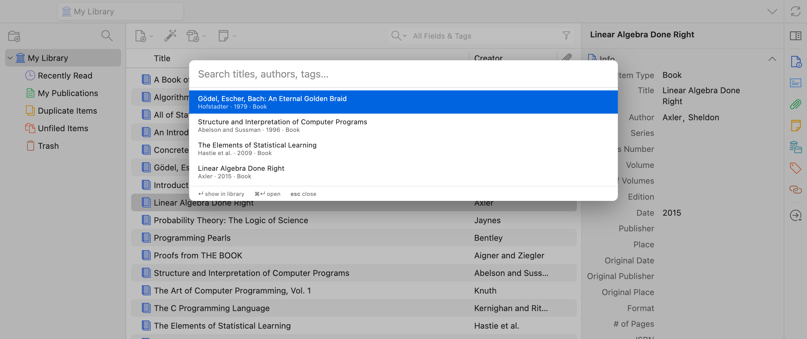
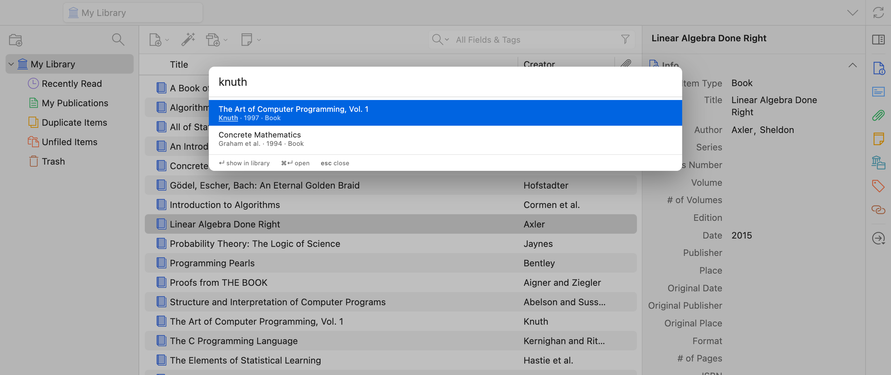
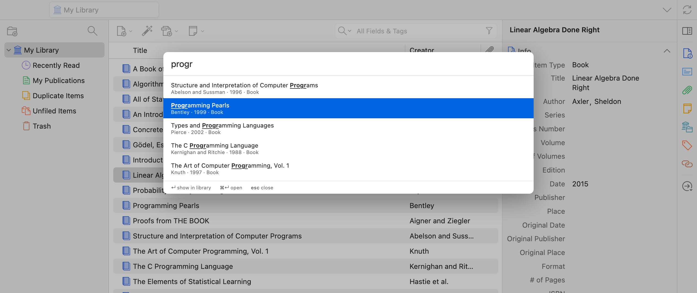

# Omnisearch for Zotero

A fast, fuzzy command palette for your Zotero library, in the spirit of
Obsidian's Omnisearch.



- **Cmd/Ctrl+G** (library or reader tabs) or **Tools → Omnisearch…** opens the
  palette
- Matches titles, authors, short titles, publications, tags, year, DOI/ISBN —
  prefix and typo tolerant, diacritic-insensitive (`godel` finds _Gödel_)
- Recently and frequently used items rank higher; an empty query lists them
- **Enter** shows the item in the library, **Cmd/Ctrl+Enter** opens it
  (best attachment, else URL/DOI), **Esc** closes

In a reader tab this replaces Cmd/Ctrl+G as "find next"; Enter in the find bar
still jumps to the next match. Esc returns focus to where it was.

| Authors                                           | Prefixes                                      | Typos                                        |
| ------------------------------------------------- | --------------------------------------------- | -------------------------------------------- |
|  |  |  |

## How it works

- At startup every regular item and standalone attachment is loaded into an
  in-memory [MiniSearch](https://github.com/lucaong/minisearch) index, kept in
  sync through `Zotero.Notifier`.
- Recency combines Zotero's own `lastRead` attachment timestamps (set on open
  and page turns, synced) with picks made from the palette (stored in the
  `extensions.zotero.omnisearch.picks` pref). Each use decays with a two-week
  half-life and boosts the search score up to 3×.

## Development

Requires Node 22+.

```sh
npm install
cp .env.example .env   # set Zotero binary and a dev profile path
npm start              # build, launch Zotero, hot reload
npm test               # run tests inside Zotero
npm run build          # .scaffold/build/omnisearch.xpi
```
